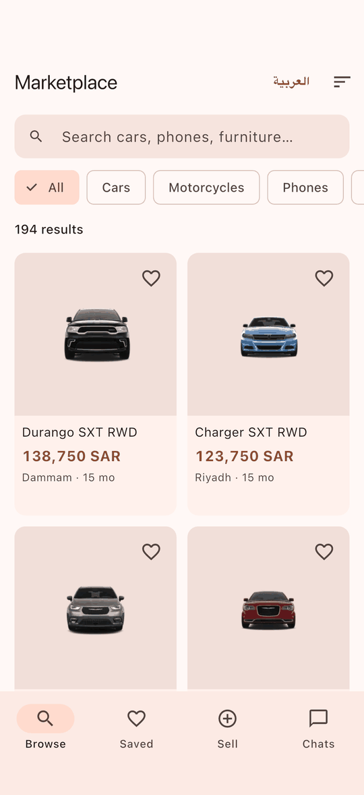
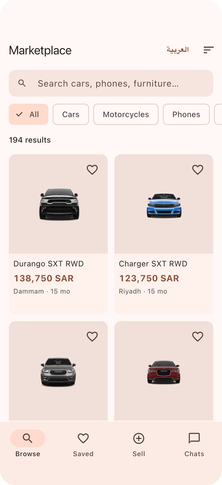
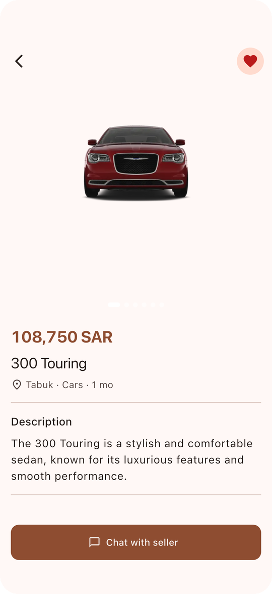
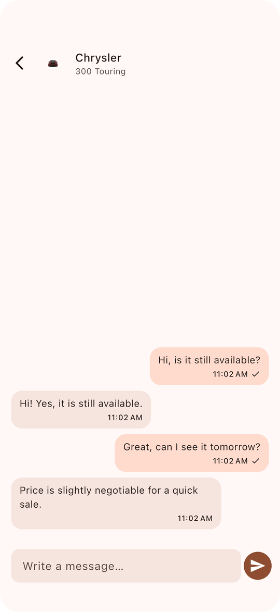
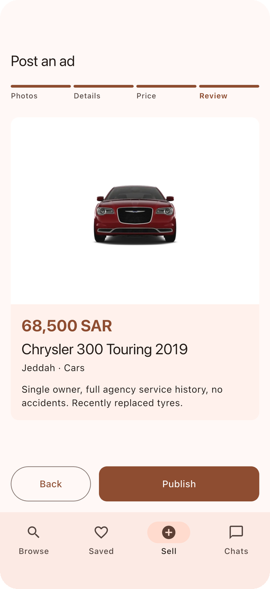
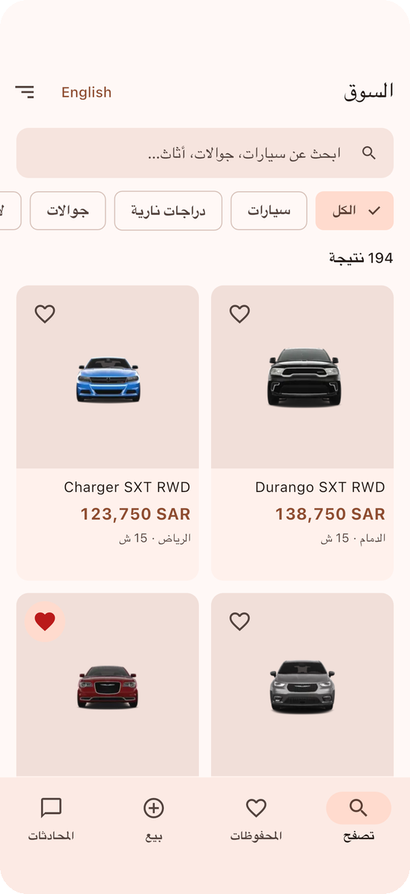

# Flutter Classifieds Marketplace

[](https://github.com/mokinan/flutter-classifieds-marketplace/actions/workflows/ci.yml)

A classifieds marketplace app in the style of Haraj, where people browse,
search, save and chat about listings, and post their own ads with photos. It
is built as a **modular monorepo** with **Riverpod**, and runs against a live
REST API.

<p align="center">
  
  
  
</p>

## Highlights

**Search that cannot show stale results.** Typing is debounced. A new query
cancels the previous HTTP request (Dio `CancelToken`), so a slow response
for an old query can never overwrite newer results.

**Offline browsing.** The first page of every query is cached on disk
(stale-while-revalidate). Offline, the app shows that page with a banner
saying how old it is, instead of an error screen. Saved listings store
snapshots and work fully offline.
→ [ADR 3](docs/adr/0003-offline-and-optimistic-ui.md)

**Optimistic UI with honest failures.**

- The heart fills instantly and rolls back if the server refuses.
- Chat messages appear as *sending…*. A failed one turns red and retries with
  the same client id, so the server never stores it twice.

**Posting an ad.** A four-step flow:

- Photos are compressed (1600 px, JPEG 80) and then uploaded with per-photo
  progress.
- A failed upload retries on its own, without restarting the others.
- The form auto-saves as a draft.
- Publishing validates every step first and jumps to the first problem.

**Deep links.** `marketplace://app/listing/167` and
`https://market.example/listing/167` open the listing directly. Details
render instantly when opened from a list, and fetch by id when opened from a
link.

**Arabic & English** with RTL, Arabic plural rules, and localized categories
and cities.

## Architecture

```
apps/marketplace          Flutter app — features, Riverpod controllers, routing
packages/marketplace_api  pure Dart — models, HTTP client, typed errors, chat transport
packages/ui_kit           design tokens + presentational widgets (no app state)
```

The members are wired with **Dart pub workspaces**: one lockfile, and strict
dependency direction (`app → ui_kit, marketplace_api`).
→ [ADR 1](docs/adr/0001-monorepo-with-pub-workspaces.md)

```
features/
├── feed/        FeedController — query, paging, debounce, cancel, offline fallback
├── listing/     details page, image carousel, deep-link fetch by id
├── favorites/   optimistic toggle with rollback, offline snapshots
├── post_ad/     multi-step form, compression, uploads, draft autosave
└── chat/        per-listing ChatController (Riverpod family), typing, retries
```

State is managed with **Riverpod 3**: plain `Notifier`s and families, no code
generation. Overrides provide dependency injection for the API, storage, clock
and photo source. Riverpod's automatic retry is turned off, so failures are
handled explicitly.
→ [ADR 2](docs/adr/0002-riverpod-for-state.md) (and why the sister project
[flutter-fintech-wallet](https://github.com/mokinan/flutter-fintech-wallet)
uses Bloc instead)

### Backend

Listings, categories and search come from the public
[DummyJSON](https://dummyjson.com) API, mapped to classifieds:

- Prices are converted to integer halalas.
- Categories are filtered to classifieds-relevant ones.
- Cities are assigned for the demo.

Chat, favorites sync and image uploads use in-process simulators with
configurable latency and failure rates, so the retry paths can be exercised.

## Testing

```bash
flutter pub get                                  # once, at the repo root
(cd packages/marketplace_api && dart test)       # 13 tests — client, errors, chat
(cd packages/ui_kit && flutter test)             # 7 tests — widgets, formatting, RTL
(cd apps/marketplace && flutter test)            # 27 tests — controllers, cache, widgets
(cd apps/marketplace && flutter drive \
  --driver=test_driver/integration_test.dart \
  --target=integration_test/app_test.dart)       # end-to-end on a simulator, live API
```

What the tests cover:

- **Feed:** paging to the end; debounced search hitting the server once;
  cancellation of a superseded query; offline fallback to the cache; a failed
  refresh keeping the items on screen.
- **Writes:** favorite rollback and persistence; chat retry without
  duplicates; upload failure followed by a single-photo retry; draft restore;
  publishing guarded by validation.
- **End-to-end:** browse → filter → open → save → chat (with seller reply) →
  search → post an ad with real photo uploads → Saved tab → Arabic. The
  screenshots in this README come from this run.

## CI

GitHub Actions runs:

- format and `flutter analyze --fatal-infos` (`very_good_analysis`) across the
  workspace;
- a test matrix, one job per package;
- an Android build, with the APK uploaded as an artifact.

## Screens

<p align="center">
  
  
  
  
</p>

## License

MIT
